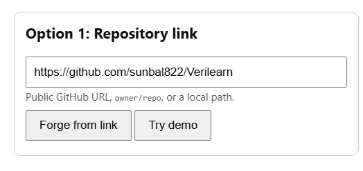
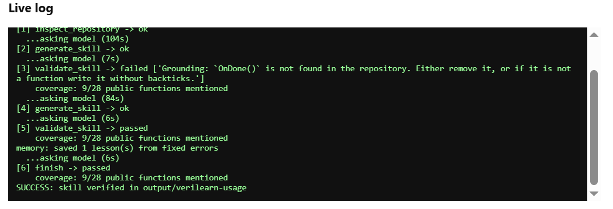
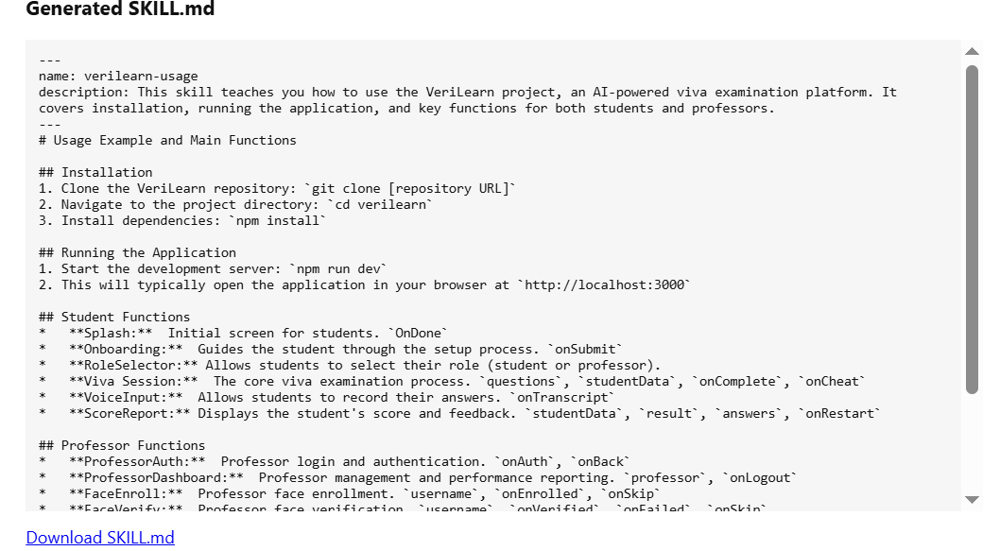

# 🛠️ SkillForge

**An open-weight agent harness that writes, validates, repairs, and remembers Agent Skills for any code repository.**

🏆 *Built for the Hacktoberfest Hack Day Lahore x Fluxxion "Best Open-Source AI Project" challenge.*

## 📖 What is SkillForge?

Paste a GitHub link or pick a local folder, and SkillForge produces an Agent Skill (`SKILL.md`) for that repository. A local open-weight model (Gemma 3 through Ollama) writes the skill, and a deterministic validator checks it. If the check fails, the error message tells the model exactly how to fix it, and the harness decides success by re-running validation itself, never by trusting the model.

It runs fully on your machine: no paid API, no cloud.

## 🧠 Model

* **Engine:** any open-weight model served by [Ollama](https://ollama.com/).
* **Tested with:** `gemma3:4b` on CPU. This is the model used for every example in `examples/`.
* **Change it:** set `FORGE_MODEL` (see Settings).

## 🚀 Quick start

**You need:** Python 3.10+ (standard library only, no pip packages), [Git](https://git-scm.com/), and [Ollama](https://ollama.com/).

### 1. Get the code
```
git clone https://github.com/sunbal822/KQS.git
cd KQS
```

### 2. Download the model (one time)
```
ollama pull gemma3:4b
```
Keep Ollama running in the background. If you use another model, set `FORGE_MODEL` first (Windows: `set FORGE_MODEL=gemma3:4b`, Linux/macOS: `export FORGE_MODEL=gemma3:4b`).

### 3. Start the web UI
```
python ui.py
```
Open http://127.0.0.1:8000 in your browser.

### 4. Forge a skill
* **Option 1, repository link:** paste a public GitHub URL or `owner/repo`, then click **Forge from link**.
* **Option 2, upload a folder:** pick a local repo folder, then click **Forge from folder**.
* **Try demo** runs the bundled `demo_repo`, the fastest way to see it work.

Watch the **Live log**. `SUCCESS` is printed only after the harness's own re-check passes. The finished `SKILL.md` appears on the page and can be downloaded.

On CPU a run takes a few minutes. Small repos (under about 15 files) are fastest.

## ⌨️ Command line

```
# GitHub repository (owner/repo) - cloned locally first
python harness.py owner/repo

# Full GitHub URL - cloned locally first
python harness.py https://github.com/spf13/cobra

# Local directory - read directly
python harness.py C:\path\to\project

# Run without memory injection
python harness.py demo_repo --no-memory
```
Skills are written to `output/<name>/SKILL.md` and the step trace to `output/trace.json`.

## ⚙️ Settings

| Variable | Default | Meaning |
|---|---|---|
| `FORGE_MODEL` | gemma3:4b | Ollama model to use |
| `FORGE_CTX` | 8192 | Context window |
| `FORGE_MAX_TOKENS` | 1000 | Max tokens per model reply |
| `FORGE_MAX_STEPS` | 8 | Step limit for the agent loop |

## 🔍 How it works

1. The harness clones the repo (or reads the local folder).
2. `inspect_repository` lists key files and the real public functions.
3. The model writes a `SKILL.md` using the `generate_skill` tool.
4. `validate_skill` checks format, naming, and that every function the skill names really exists (grounding check). It also reports coverage.
5. If validation fails, the error gives the exact fix and the model retries.
6. On `finish`, the harness re-runs validation. Success is decided by code, not by the model.

### See it in action

**1. The web UI.** Two inputs: a repository link or a folder upload.


**2. Paste a repository link.** A public GitHub URL, `owner/repo`, or a local path.



**3. Watch the repair loop in the live log.** The validator rejects a function that does not exist in the repository (`OnDone()`), the model fixes it, validation passes, a lesson is saved to memory, and the harness prints `SUCCESS` only after its own re-check.



**4. Get the generated skill.** The finished `SKILL.md` appears on the page and can be downloaded.



## 📂 Examples

`examples/` holds real runs, each with the generated `SKILL.md` and a `trace.json` showing every step.

## 📐 Agent Skill checks

The validator checks the key rules of the Agent Skill format:

1. **Frontmatter** with `name` and `description`.
2. **Name** is `lowercase-with-hyphens` and equals its folder name.
3. **Description and body length** are within limits.
4. **No unclosed code blocks.**
5. **Grounding:** at least one real function is mentioned, and every named function must exist in the target repository.

## 🛠️ Original contributions

All core components were written from scratch for this project:

* The agent loop and step-budget controller.
* The context builder and progressive disclosure (`load_skill`).
* The tool registry: `load_skill`, `inspect_repository`, `generate_skill`, `validate_skill`, `finish`.
* Argument validation, JSON parsing and automatic retry.
* An API extractor for Python, JavaScript, TypeScript, Go and Rust.
* A deterministic validator with a grounding check that rejects invented functions.
* Experience memory (`memory.py`): lessons from errors the model later fixed are saved to `memory.json` and injected into future runs, with no weight training.
* A web UI (`ui.py`) with repository-link and folder-upload inputs and a live log.
* A bundled skill: `skills/skillforge/SKILL.md`.

## ⚠️ Known limits

* Slow on CPU, and a 4B model can leave placeholders such as `git clone [repository URL]`.
* Coverage (how many public functions the skill mentions) is reported, not required.
* Function extraction supports Python, JavaScript, TypeScript, Go and Rust.
* The UI runs one job at a time, and there is no second-agent evaluation yet.

## 🧪 Tests (no model needed)

Windows users: run `set PYTHONPATH=.` first.

```
# Repair loop: malformed JSON, hallucinated functions, bad names
PYTHONPATH=. python tests/test_loop.py

# Memory: lessons are saved and injected into later runs
PYTHONPATH=. python tests/test_memory.py
```

## 📜 License

MIT License. See [LICENSE](LICENSE).

*Developed for Hacktoberfest.*
